# تقرير تنفيذ المرحلة 1: نقل تصميم الموقع إلى Next.js

**المشروع:** ROTANA Hair Style
**المستودع:** `v476b4n57h-tech/rotana`
**فرع العمل:** `claude/intelligent-fermat-o1jgwp`
**التاريخ:** 25 نوفمبر 2026
**الحالة:** ✅ المرحلة 1 مكتملة · ✅ مرفوعة إلى GitHub · **CI_STATUS** · ✅ `main` لم يتغير

---

## الفهرس

1. [الخلاصة](#1-الخلاصة)
2. [ما تم الالتزام به من طلباتك](#2-ما-تم-الالتزام-به-من-طلباتك)
3. [ماذا فعلنا؟ شرح مبسّط](#3-ماذا-فعلنا-شرح-مبسط)
4. [التعديلات بالتفصيل](#4-التعديلات-بالتفصيل)
5. [الملفات الجديدة ووظيفة كل ملف](#5-الملفات-الجديدة-ووظيفة-كل-ملف)
6. [المقارنة مع التصميم الأصلي](#6-المقارنة-مع-التصميم-الأصلي)
7. [سرعة الموقع: قبل وبعد](#7-سرعة-الموقع-قبل-وبعد)
8. [نتائج الاختبارات](#8-نتائج-الاختبارات)
9. [لقطات شاشة للموقع الجديد](#9-لقطات-شاشة-للموقع-الجديد)
10. [المشاكل التي واجهتها وكيف حللتها](#10-المشاكل-التي-واجهتها-وكيف-حللتها)
11. [ملاحظات وقرارات تحتاج رأيك](#11-ملاحظات-وقرارات-تحتاج-رأيك)
12. [حالة GitHub](#12-حالة-github)
13. [الخطوة التالية](#13-الخطوة-التالية)

---

## 1. الخلاصة

- **الموقع كله أُعيد بناؤه بـ Next.js**، وكل قسم وزر وحركة يعمل كما في الأصل.
- **المظهر مطابق للأصل:** قارنّا لقطات الشاشة نقطةً بنقطة (pixel) على 3 أحجام شاشة، في الوضعين الفاتح والليلي، وفي 5 حالات تفاعلية. أكبر فرق كان **0.085%** من النقاط، أي أقل من نقطة واحدة من كل ألف، وهو غير مرئي للعين. الفرق الوحيد سببه أن الصور أصبحت بصيغة أخف.
- **الموقع أسرع بكثير:**
  - حجم التحميل نزل من **2,132 KB إلى حوالي 375 KB** (أقل بـ 82%).
  - على جوال بشبكة بطيئة، اكتمل التحميل في **2.5 ثانية بدل 8.1 ثانية**.
- **كل الاختبارات نجحت:** 22 اختباراً سريعاً، و52 اختبار سلوك على 3 أنواع أجهزة، و16 اختبار مقارنة بصرية.
- **التعليقات داخل الكود أصبحت بالإنجليزية**، كما طلبت.

---

## 2. ما تم الالتزام به من طلباتك

| طلبك                                          | الحالة                                            |
| --------------------------------------------- | ------------------------------------------------- |
| نقل تصميم الموقع بالكامل إلى Next.js          | ✅ كل الأقسام بنفس الترتيب                        |
| المحافظة على الألوان والصور والخطوط والحركات  | ✅ ملفات التصميم منسوخة حرفياً، مع اختبارات تحرسها |
| الوضع الفاتح والليلي                          | ✅ مختبران ومتطابقان مع الأصل                     |
| تحسين سرعة الصور والموقع                      | ✅ أخف بـ 82%، وأسرع بـ 3 مرات على الجوال         |
| التوافق مع الكمبيوتر والجوال والأجهزة اللوحية | ✅ كل الاختبارات تعمل على الثلاثة                 |
| مقارنة التصميم بالأصل باختبارات ولقطات شاشة   | ✅ 16 مقارنة آلية + صور في هذا التقرير            |
| التعليقات بالإنجليزية والتقارير بالعربية      | ✅                                                |
| رفع التعديلات إلى فرع العمل                   | ✅                                                |
| تشغيل جميع الاختبارات                         | ✅                                                |
| عدم الدمج في `main`                           | ✅ `main` ما زال عند `7292fb5`                    |
| عدم حذف النسخة الأصلية                        | ✅ `index.html` لم يتغير (بصمته مطابقة)           |
| عدم شراء خدمات مدفوعة                         | ✅                                                |
| عدم بدء المرحلة 2                             | ✅                                                |

---

## 3. ماذا فعلنا؟ شرح مبسّط

تخيّل الموقع الأصلي **كتاباً مطبوعاً في ورقة واحدة ضخمة**: كل النصوص والصور (22 صورة) والتصميم والبرمجة داخل ملف واحد حجمه 2 ميغابايت. يعمل، لكن:

- الزائر يجب أن يحمّل الملف كله، حتى صور لن يراها.
- أي تعديل يعني فتح هذا الملف الضخم والبحث داخله.
- لا يمكن ربطه بقاعدة بيانات أو حسابات.

ما فعلناه هو **تفكيك الكتاب إلى فصول مرتبة**، دون تغيير كلمة أو لون:

| الأصل                            | الجديد                                                          |
| -------------------------------- | --------------------------------------------------------------- |
| ملف واحد فيه كل شيء              | كل قسم في ملف خاص (الرأس، الخدمات، المعرض، الحجز…)              |
| الصور مدفونة داخل الملف كنص طويل | الصور ملفات مستقلة، والموقع يرسل لكل جهاز الحجم الذي يحتاجه فقط |
| النصوص مختلطة بالبرمجة           | النصوص في ملفات منفصلة، فيسهل تعديلها أو ترجمتها                |
| لا اختبارات                      | 90 اختباراً آلياً تحرس الموقع من الأخطاء                          |

> **ما هو "المكوّن" (Component)؟** قطعة مستقلة من الموقع، مثل قطعة "ليغو". مثلاً `Gallery.tsx` هو المعرض كاملاً: الصور والفلاتر ونافذة العرض. يمكن تعديله دون لمس بقية الموقع.

---

## 4. التعديلات بالتفصيل

### 4.1 التصميم (CSS): منسوخ حرفياً

- **`src/app/globals.css`:** الألوان (فاتح وليلي) والقواعد الأساسية، من المرحلة 0.
- **`src/app/site.css` (جديد):** **بقية تصميم الأصل كاملاً**، 140 سطراً منسوخة حرفاً بحرف: التخطيط، والأزرار، والشريط المتحرك، والسلايدر، والمعرض، ونافذة الصور، والحجز.
- **اختبارات الحماية:**
  - اختبار يتأكد أن **كل سطر من تصميم الأصل** (أكثر من 150 سطراً) موجود في الملفات الجديدة.
  - الملفان مستثنيان من أدوات التنسيق الآلي حتى لا تغيّرهما.

### 4.2 الصفحة: نفس البنية بالضبط

حافظت على **نفس عناصر HTML ونفس أسماء الكلاسات والمعرّفات** (مثل `#svc-panel` و `.tile` و `#book`). لذلك يطبّق التصميم الأصلي نفسه دون أي تعديل. الأقسام بنفس الترتيب:

الرأس ← الواجهة ← الشريط المتحرك ← صور الأجواء ← لماذا ROTANA ← الخدمات والأسعار ← أعمالنا ← نافذة الصور ← حجز موعد ← حسابي ← التواصل ← التذييل

### 4.3 التفاعل والحركات: كلها تعمل كما في الأصل

| الوظيفة                                                       | الحالة          |
| ------------------------------------------------------------- | --------------- |
| الكلمة المتبدلة "hem ← haar ← hem en haar"                    | ✅ كل 2.8 ثانية |
| سلايدر الصور مع النقاط، ويتوقف عند مرور الماوس                | ✅              |
| ظهور الأقسام تدريجياً عند التمرير                              | ✅              |
| الشريط المتحرك (Knippen · Baard…)                             | ✅              |
| حركة "الطفو" لصورة الواجهة ولمعان الشعار                      | ✅              |
| لوحة الخدمات: فتح، واختيار رجال/نساء، ورجوع، وإغلاق           | ✅              |
| روابط "Diensten en prijzen" تفتح لوحة الخدمات                 | ✅              |
| المعرض: فتح، وفلترة، ونافذة صور بالأسهم والكيبورد (Esc، ←، →) | ✅              |
| رابط "Ons werk" يفتح المعرض                                   | ✅              |
| الحجز التجريبي: كل الخطوات الخمس بنفس الشكل والنصوص           | ✅              |
| رسائل "Dit is een demo" للحساب والتواصل الاجتماعي             | ✅              |
| احترام إعداد "تقليل الحركة" في الجهاز                         | ✅              |
| بدون JavaScript يبقى كل المحتوى ظاهراً                         | ✅              |

### 4.4 الصور: أخف بكثير

1. **استخرجت الصور الـ 22** من داخل الملف الأصلي إلى ملفات مستقلة في `src/assets/images/`.
2. الموقع الآن يرسل الصور بـ**صيغ حديثة (AVIF و WebP)**، وهي أخف بكثير من JPEG بنفس الجودة.
3. **كل جهاز يأخذ الحجم الذي يحتاجه:** الجوال لا يحمّل صورة بحجم شاشة كمبيوتر.
4. **الصور التي لا تظهر مباشرة لا تُحمَّل** إلا عند الحاجة (مثلاً صور المعرض لا تُحمَّل إلا عند فتحه).
5. **صورة الواجهة تُحمَّل أولاً** لأنها أول ما يراه الزائر.

**مثال:** صورة لافتة ROTANA كانت **179 KB**، وأصبحت **18 KB** بنفس الشكل.

### 4.5 السرعة: إضافات أخرى

- **الخطوط من نفس الموقع:** بدل الاتصال بـ Google عند كل زيارة. هذا أسرع، وأفضل للخصوصية لأن متصفح الزائر لا يتصل بـ Google.
- **التصميم مدمج داخل الصفحة:** يوفّر رحلة اتصال كاملة قبل أول ظهور للموقع.
- **الأيقونات (إنستغرام، تيك توك، فيسبوك، واتساب)** أصبحت رسومات صغيرة داخل الصفحة، بدل تحميل ملف أيقونات كامل من الإنترنت.

### 4.6 فصل المحتوى عن الكود

| الملف                       | ماذا يحتوي                                                               | المستقبل                                                        |
| --------------------------- | ------------------------------------------------------------------------ | --------------------------------------------------------------- |
| `src/content/rotana.ts`     | محتوى الصالون: الخدمات، والفريق التجريبي، وساعات العمل، والعنوان، والصور | ينتقل إلى قاعدة البيانات ويُعدَّل من لوحة الإدارة (المرحلتان 3 و4) |
| `src/i18n/messages/nl.json` | نصوص الواجهة بالهولندية: أسماء الأزرار، ورسائل الحجز…                    | إضافة لغة = إضافة ملف                                           |

**الأسعار مخزّنة بالسنت** (حسب الخطة المالية)، وحالياً فارغة فتظهر `[€ PRIJS]` كما في الأصل. عند إدخال سعر، يظهر تلقائياً بالتنسيق الهولندي (مثل € 25,00).

**كل العناصر المؤقتة في الأصل بقيت كما هي:** `[€ PRIJS]`، و`[TELEFOON]`، و`[KVK-NUMMER]`، والأسماء التجريبية للحلاقين. ستُملأ من لوحة الإدارة لاحقاً.

### 4.7 التعليقات بالإنجليزية

ترجمت كل التعليقات داخل الكود من الهولندية إلى الإنجليزية، بما فيها ملفات المرحلة 0. نصوص الموقع نفسه بقيت بالهولندية.

---

## 5. الملفات الجديدة ووظيفة كل ملف

**المجموع منذ المرحلة 0:** 62 ملفاً جديداً و26 ملفاً معدّلاً. الملف الأصلي `index.html` **لم يتغير**.

### 5.1 الموقع

| الملف                                                 | الوظيفة                                               |
| ----------------------------------------------------- | ----------------------------------------------------- |
| `src/app/page.tsx`                                    | **الصفحة الرئيسية:** تجمع الأقسام بنفس ترتيب الأصل    |
| `src/app/layout.tsx`                                  | الإطار العام: اللغة الهولندية، والخطوط، وعنوان الصفحة |
| `src/app/site.css`                                    | **تصميم الأصل** منسوخاً حرفياً                          |
| `src/components/site/Header.tsx`                      | الرأس: الشعار والقائمة                                |
| `src/components/site/Hero.tsx`                        | الواجهة: العنوان والصورة والأزرار                     |
| `src/components/site/RotatingWord.tsx`                | الكلمة المتبدلة "hem / haar"                          |
| `src/components/site/Ticker.tsx`                      | الشريط المتحرك                                        |
| `src/components/site/MoodSliders.tsx` و `Slider.tsx`  | صور الأجواء (رجال/نساء) مع النقاط                     |
| `src/components/site/WhyUs.tsx`                       | قسم "Waarom ROTANA"                                   |
| `src/components/site/Services.tsx`                    | الخدمات والأسعار                                      |
| `src/components/site/Gallery.tsx`                     | المعرض والفلاتر ونافذة عرض الصور                      |
| `src/components/site/Booking.tsx`                     | **الحجز التجريبي** (يصبح حقيقياً في المرحلة 5)         |
| `src/components/site/Account.tsx`                     | قسم "Mijn account"                                    |
| `src/components/site/Contact.tsx` و `SocialLinks.tsx` | التواصل، وساعات العمل، وأيقونات التواصل الاجتماعي     |
| `src/components/site/Footer.tsx`                      | التذييل                                               |
| `src/components/site/RevealOnScroll.tsx`              | ظهور الأقسام عند التمرير                              |
| `src/components/site/priceLabel.ts`                   | عرض السعر، أو `[€ PRIJS]` إن لم يُحدَّد                  |
| `src/content/rotana.ts`                               | **محتوى الصالون** (مؤقتاً)                             |
| `src/assets/images/` (22 صورة)                        | الصور المستخرجة من الأصل                              |
| `src/i18n/messages/nl.json`                           | نصوص الواجهة الهولندية                                |

### 5.2 الاختبارات

| الملف                                 | ماذا يختبر                                            |
| ------------------------------------- | ----------------------------------------------------- |
| `tests/unit/design-tokens.test.ts`    | أن كل سطر من تصميم الأصل موجود حرفياً                  |
| `tests/unit/content.test.ts`          | أن كل الخدمات والصور والأوصاف مطابقة للأصل كلمة بكلمة |
| `tests/unit/legacy-integrity.test.ts` | أن الملف الأصلي لم يتغير                              |
| `tests/e2e/site.spec.ts`              | **سلوك الموقع:** كل زر ولوحة وحركة والحجز كاملاً       |
| `tests/e2e/smoke.spec.ts`             | الأساسيات: اللغة، والألوان، والخطوط، والأمان          |
| `tests/e2e/performance.spec.ts`       | السرعة وحجم التحميل وصيغ الصور                        |
| `tests/visual/compare.spec.ts`        | **المقارنة البصرية** مع الأصل                         |
| `tests/visual/harness.ts`             | أدوات تفتح النسختين بظروف متطابقة وتقارن الصور        |
| `tests/visual/report-shots.spec.ts`   | يصنع لقطات الشاشة لهذا التقرير                        |
| `playwright.visual.config.ts`         | إعدادات المقارنة البصرية                              |

### 5.3 الإعدادات والتوثيق

| الملف                      | التغيير                                                          |
| -------------------------- | ---------------------------------------------------------------- |
| `next.config.ts`           | صيغ الصور الحديثة، ودمج التصميم في الصفحة                        |
| `package.json`             | أوامر جديدة: `npm run test:visual`، و`npm run check` يشغّل كل شيء |
| `.github/workflows/ci.yml` | GitHub يشغّل المقارنة البصرية أيضاً، ويحفظ صورها                   |
| `playwright.config.ts`     | الاختبارات على 3 أجهزة: كمبيوتر، ولوحي، وجوال                    |
| `README.md`                | تحديث الحالة والهيكل والأوامر                                    |
| `docs/reports/phase-1/`    | هذا التقرير ولقطات الشاشة                                        |

---

## 6. المقارنة مع التصميم الأصلي

### 6.1 كيف قارنّا؟

برنامج آلي يفتح **الموقع الأصلي والموقع الجديد** في نفس المتصفح وبنفس الظروف: نفس حجم الشاشة، ونفس التاريخ، والحركات متوقفة. ثم يلتقط صورة لكل منهما ويقارنهما **نقطة بنقطة**، ويحسب نسبة النقاط المختلفة.

> **مثال:** شاشة الكمبيوتر الكاملة فيها أكثر من 5 ملايين نقطة. فرق 0.058% يعني حوالي 3,000 نقطة فقط، كلها داخل الصور، لأن الصور أعيد ضغطها بصيغة أخف.

### 6.2 النتائج: الصفحة كاملة

| الشاشة         | الوضع | الطول (أصلي / جديد) | نسبة الاختلاف |
| -------------- | ----- | ------------------- | ------------- |
| كمبيوتر 1280px | فاتح  | 4227 / 4227         | 0.058%        |
| كمبيوتر 1280px | ليلي  | 4227 / 4227         | 0.058%        |
| لوحي 820px     | فاتح  | 4798 / 4798         | 0.080%        |
| لوحي 820px     | ليلي  | 4798 / 4798         | 0.080%        |
| جوال 390px     | فاتح  | 6272 / 6272         | 0.071%        |
| جوال 390px     | ليلي  | 6272 / 6272         | 0.072%        |

**طول الصفحة متطابق تماماً** في كل الشاشات، أي أن كل عنصر في مكانه بالضبط.

### 6.3 النتائج: الحالات التفاعلية

البرنامج يضغط نفس الأزرار في النسختين ثم يقارن:

| الحالة                          | كمبيوتر    | جوال       |
| ------------------------------- | ---------- | ---------- |
| فتح الخدمات واختيار "Heren"     | 0.047%     | 0.061%     |
| فتح المعرض وفلترة "Dames"       | 0.059%     | 0.073%     |
| فتح صورة في نافذة العرض         | **0.000%** | **0.000%** |
| الحجز كاملاً حتى رسالة التأكيد   | 0.051%     | 0.062%     |
| رسائل الحساب والتواصل الاجتماعي | 0.085%     | 0.071%     |

### 6.4 صورة المقارنة

من اليسار: **الأصل**، ثم **الجديد**، ثم **خريطة الاختلاف** (النقاط الحمراء هي الاختلافات، وتظهر فقط داخل صورة اللافتة بسبب إعادة ضغطها):

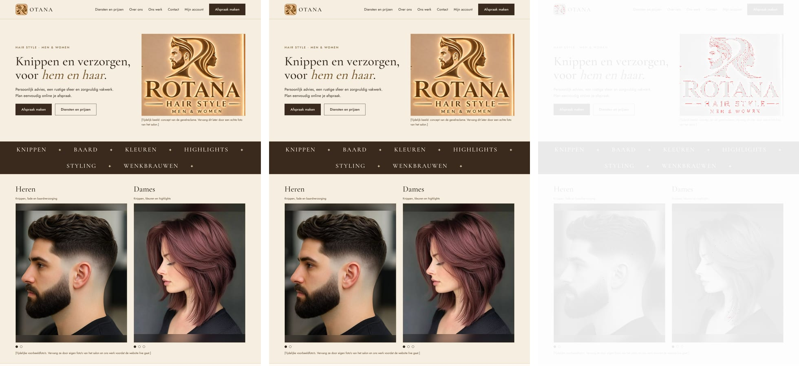

---

## 7. سرعة الموقع: قبل وبعد

قسنا النسختين بنفس الطريقة، مع ضغط الملفات كما تفعل أي استضافة حقيقية:

| القياس                                   | الأصل      | الجديد     | التحسن             |
| ---------------------------------------- | ---------- | ---------- | ------------------ |
| **حجم التحميل** (كمبيوتر)                | 2,132 KB   | 376 KB     | **أخف بـ 82%**     |
| **حجم التحميل** (جوال)                   | 2,132 KB   | 431 KB     | **أخف بـ 80%**     |
| **أول ظهور** (جوال، شبكة 4G بطيئة)       | 0.39 ثانية | 0.32 ثانية | أسرع               |
| **اكتمال التحميل** (جوال، شبكة 4G بطيئة) | 8.1 ثانية  | 2.5 ثانية  | **أسرع بـ 3 مرات** |
| **اكتمال التحميل** (كمبيوتر)             | 0.43 ثانية | 0.16 ثانية | أسرع               |
| صورة اللافتة                             | 179 KB     | 18 KB      | أخف بـ 90%         |

> **لماذا هذا مهم؟** زوار الصالون غالباً على الجوال. كل ثانية انتظار تُفقد زبائن، و Google يرتّب المواقع الأسرع أعلى في نتائج البحث.

---

## 8. نتائج الاختبارات

### 8.1 ملخص

| الفحص                        | العدد | النتيجة                    |
| ---------------------------- | ----- | -------------------------- |
| جودة الكود (ESLint)          | -     | ✅ 0 أخطاء                 |
| الأنواع (TypeScript)         | -     | ✅ 0 أخطاء                 |
| التنسيق (Prettier)           | -     | ✅                         |
| الاختبارات السريعة (Vitest)  | 22    | ✅ 22 نجحت                 |
| بناء الموقع (Build)          | -     | ✅                         |
| اختبارات السلوك (Playwright) | 54    | ✅ 52 نجحت · 2 متخطاة عمداً |
| المقارنة البصرية             | 16    | ✅ 16 نجحت                 |
| الثغرات الأمنية في المكتبات  | -     | ✅ 0                       |
| بصمة الملف الأصلي            | -     | ✅ مطابقة                  |

**عن الاختبارين المتخطيين:** اختبار رابط "Ons werk" في القائمة يُشغَّل على الكمبيوتر واللوحي فقط، لأنه نفس الرابط على الجوال. ومولّد لقطات التقرير (15 اختباراً) لا يعمل إلا عند الطلب.

### 8.2 اختبارات السلوك (18 اختباراً × 3 أجهزة)

كل اختبار يعمل على **كمبيوتر** و**جهاز لوحي** و**جوال**، ويتأكد أيضاً أنه **لا توجد أي أخطاء** في المتصفح:

| الاختبار                | ماذا يتأكد                                                                 |
| ----------------------- | -------------------------------------------------------------------------- |
| الأقسام بترتيب الأصل    | نفس الأقسام العشرة بنفس الترتيب                                            |
| لا تمرير أفقي           | الموقع لا يخرج عن عرض الشاشة                                               |
| لوحة الخدمات            | فتح، 8 خدمات رجالية، 6 نسائية، رجوع، إغلاق                                 |
| رابط الخدمات في الواجهة | يفتح اللوحة وينتقل إليها                                                   |
| المعرض                  | 10 صور، فلترة (3 نساء / 7 رجال)، نافذة عرض، أسهم، Esc، عودة التركيز للصورة |
| رابط "Ons werk"         | يفتح المعرض                                                                |
| الحجز التجريبي          | كل الخطوات: Dames ← Lotte ← Highlights ← يوم ← وقت ← تأكيد ← رجوع          |
| الحساب والتواصل         | رسائل "Dit is een demo" الصحيحة، و4 أيقونات                                |
| الحركات                 | الكلمة المتبدلة، والسلايدر التلقائي، وظهور الأقسام، والشريط المتحرك        |
| نقاط السلايدر           | الضغط على نقطة يغيّر الصورة                                                 |
| تقليل الحركة            | الحركات تتوقف وكل المحتوى ظاهر                                             |
| بدون JavaScript         | المحتوى يبقى ظاهراً                                                         |
| اللغة والألوان          | هولندية، ولون الخلفية الأصلي                                               |
| الوضع الليلي            | لون الخلفية الليلي الأصلي                                                  |
| الخطوط                  | Cormorant Garamond و Jost محمّلان                                           |
| الأمان                  | ترويسات الأمان مفعّلة                                                       |
| السرعة                  | الصفحة أخف من نصف الأصل                                                    |
| صيغ الصور               | كل الصور AVIF أو WebP                                                      |

### 8.3 الاختبارات السريعة (22)

- **حماية الأصل (1):** `index.html` لم يتغير.
- **التصميم (5):** الألوان، وكل أسطر تصميم الأصل، والخطوط والأوزان.
- **المحتوى (4):** الخدمات، وصور المعرض وأوصافها، وصور السلايدر، والفريق التجريبي، كلها مطابقة للأصل.
- **المال و BTW (7):** من المرحلة 0.
- **اللغة والوظائف (5).**

---

## 9. لقطات شاشة للموقع الجديد

### 9.1 الكمبيوتر

**الوضع الفاتح:**

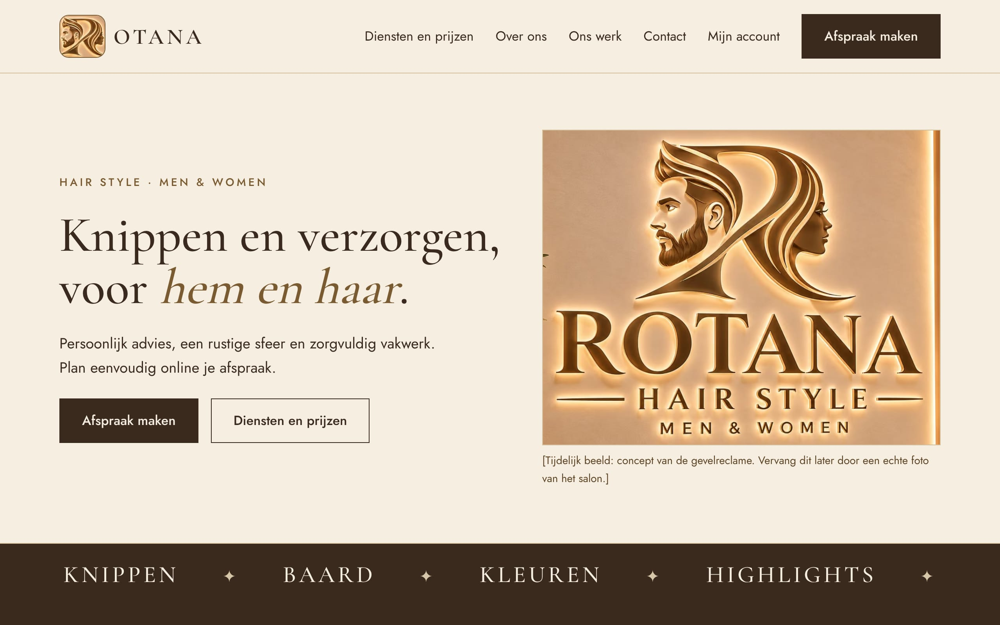

**الوضع الليلي:**

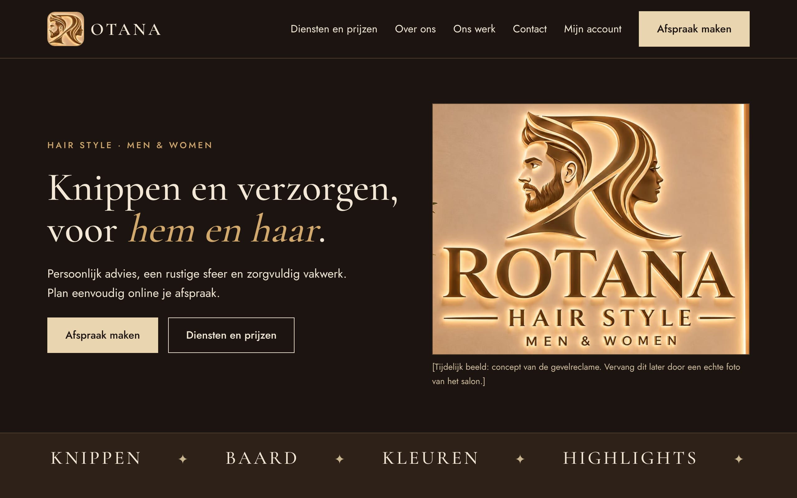

**الصفحة كاملة:** [desktop-full-page.jpg](screenshots/desktop-full-page.jpg)

### 9.2 الجوال

| الوضع الفاتح                                        | الوضع الليلي                                       |
| --------------------------------------------------- | -------------------------------------------------- |
| 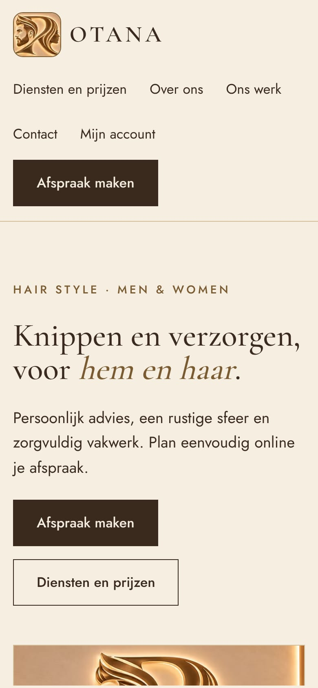 | 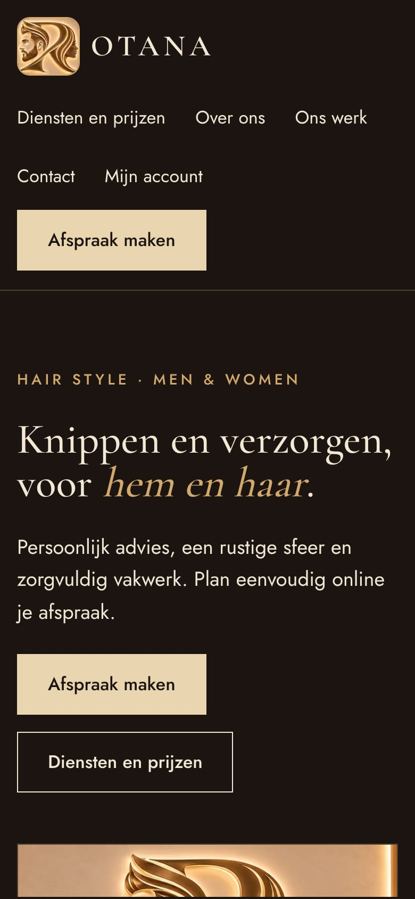 |

**الصفحة كاملة:** [mobile-full-page.jpg](screenshots/mobile-full-page.jpg)

### 9.3 الجهاز اللوحي

| الوضع الفاتح                                        | الوضع الليلي                                       |
| --------------------------------------------------- | -------------------------------------------------- |
| 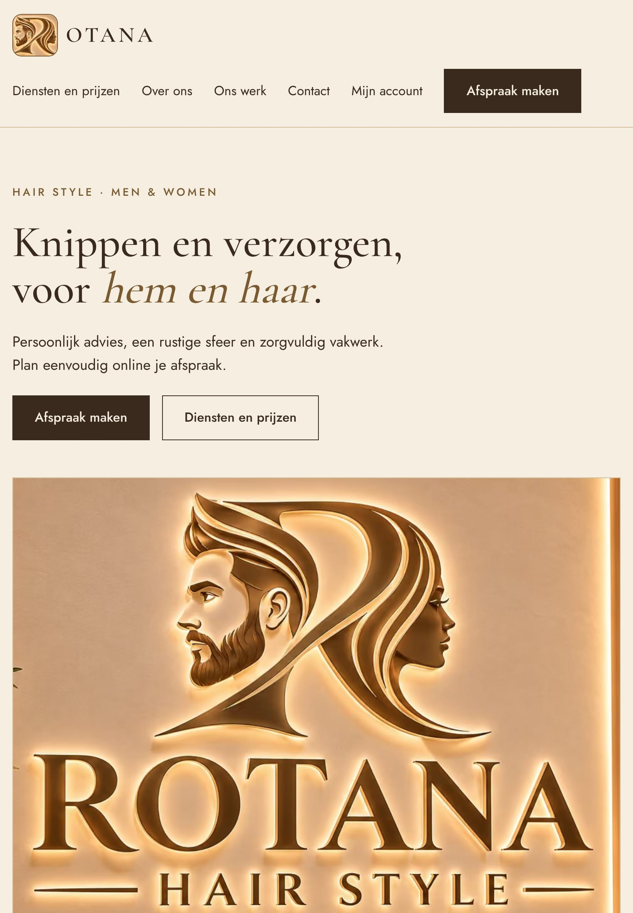 | 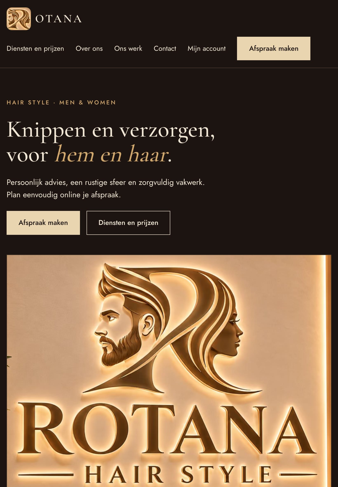 |

**الصفحة كاملة:** [tablet-full-page.jpg](screenshots/tablet-full-page.jpg)

### 9.4 الأقسام التفاعلية

**الخدمات والأسعار (بعد اختيار "Heren"):**

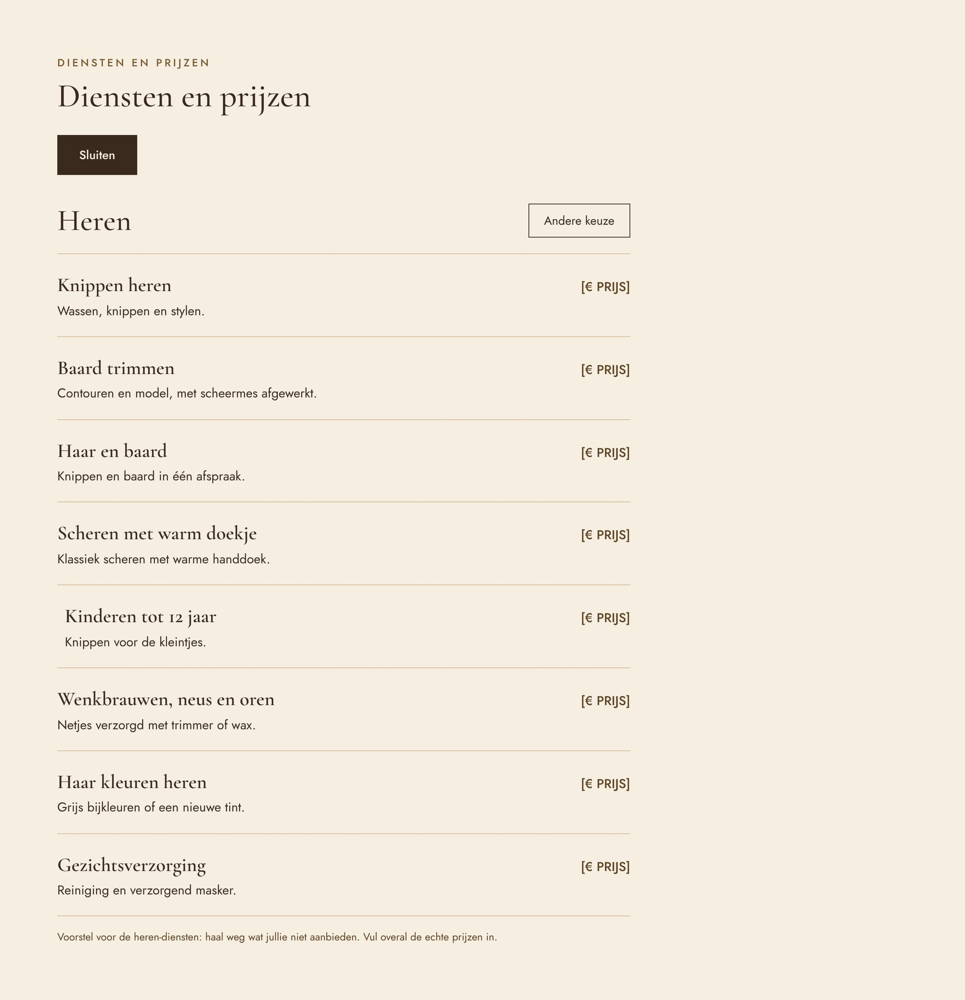

**المعرض:**

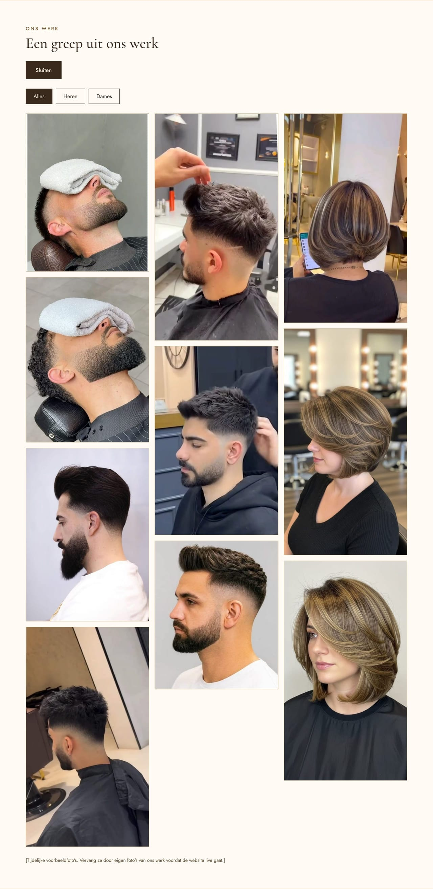

**نافذة عرض الصور:**

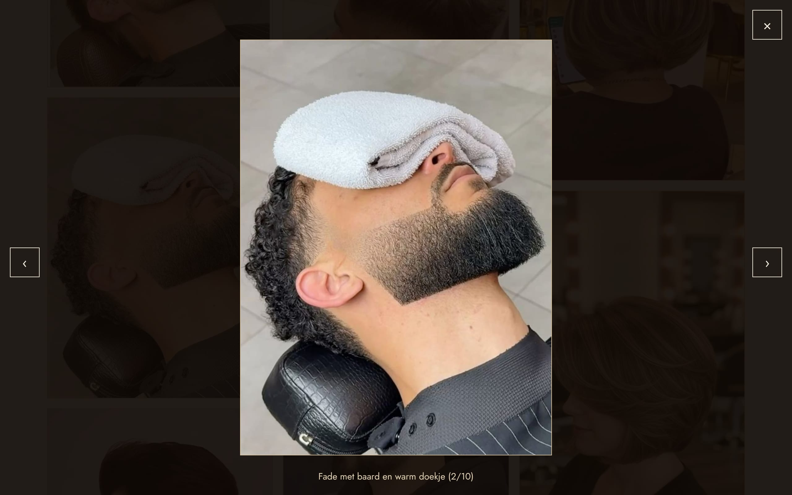

**الحجز التجريبي حتى رسالة التأكيد:**

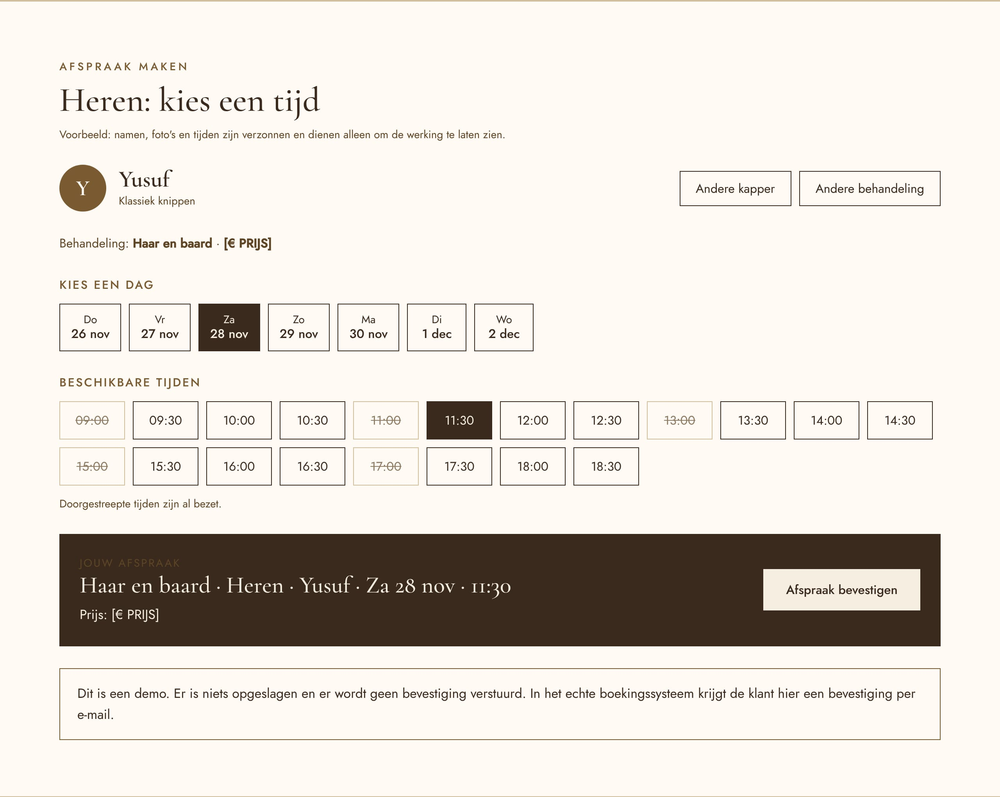

**التواصل وساعات العمل:**

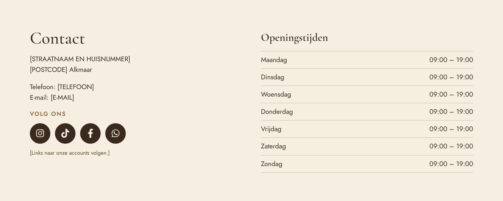

---

## 10. المشاكل التي واجهتها وكيف حللتها

### 10.1 مشكلة: موقع الأيقونات محجوب في بيئة العمل

- **ماذا حدث؟** الموقع الأصلي يحمّل أيقونات التواصل الاجتماعي من موقع خارجي (cdnjs)، وهذا الموقع محجوب في بيئة العمل السحابية. فظهرت في الأصل كلمات بدل الأيقونات، والمقارنة ستكون ظالمة.
- **الحل:** أثناء الاختبار فقط، يأخذ الأصل نفس ملفات الأيقونات (نفس الإصدار 6.4.0) من نسخة محلية. الموقع الأصلي نفسه لم يتغير.

### 10.2 مشكلة: الاختبار علق ولم ينتهِ

- **ماذا حدث؟** برنامج المقارنة ينتظر تحميل كل الصور قبل التصوير. لكن صور المعرض داخل لوحة مغلقة، والمتصفح لا يحمّلها أصلاً (وهذا سلوك صحيح لتوفير البيانات). فانتظر البرنامج إلى الأبد.
- **الحل:** الانتظار للصور الظاهرة فقط، مع حد أقصى 5 ثوانٍ.

### 10.3 مشكلة: فرق بمقدار ربع بكسل

- **ماذا حدث؟** المقارنة الأولى أظهرت أن الصفحة الجديدة أطول بـ 1 بكسل. بعد قياس كل عنصر في النسختين، وجدت أن **صورة الواجهة وحدها أطول بـ 0.26 بكسل**. السبب: عند تصغير الصورة لصيغة أخف، تتغير نسبة العرض إلى الارتفاع تغيراً ضئيلاً جداً بسبب التقريب، فينزاح كل ما تحتها.
- **الحل:** تثبيت النسبة الأصلية لكل صورة (960×760 للافتة). ثم ضبط تطبيق هذه النسبة داخل الإطار الرفيع للصورة تماماً كالأصل. النتيجة: نفس الطول بالضبط، ونسبة الاختلاف نزلت من 0.4% إلى 0.06%.

### 10.4 مشكلة: الخادم القديم ما زال يعمل

- **ماذا حدث؟** بعد التصحيح أظهرت المقارنة نفس النتيجة القديمة. اكتشفت أن نسخة قديمة من الموقع ما زالت تعمل في الخلفية، لأن أمر الإيقاف لم يجدها (اسم العملية مختلف).
- **الحل:** إيقافها باسمها الصحيح، ثم إعادة البناء والتشغيل. **الدرس:** التأكد دائماً أن ما نختبره هو آخر نسخة.

### 10.5 مشكلة: نافذة الصور على الجوال اختلفت بنسبة 80%

- **ماذا حدث؟** النافذة نفسها كانت متطابقة، لكن الصفحة خلفها كانت في موضع تمرير مختلف. السبب أن الموقع يستخدم "التمرير الناعم"، والصورة التُقطت بينما إحدى النسختين ما زالت تتحرك.
- **الحل:** انتظار توقف التمرير تماماً قبل التصوير. النتيجة: **0.000%**، وثابتة في 3 تشغيلات متتالية.

### 10.6 مشكلة: أول ظهور على الجوال البطيء كان أبطأ قليلاً

- **ماذا حدث؟** الأصل ملف واحد يبدأ المتصفح بعرضه فوراً. الجديد كان ينتظر ملف التصميم منفصلاً، فكان أول ظهور 0.61 ثانية مقابل 0.38 ثانية.
- **الحل:** دمج التصميم داخل الصفحة نفسها (خاصية `inlineCss` في Next.js). النتيجة: **0.32 ثانية، أسرع من الأصل**.

### 10.7 مشكلة: فشل الفحص الآلي على GitHub (المرة الأولى)

- **ماذا حدث؟** على جهازي نجح كل شيء، لكن على GitHub فشل فحص الأنواع: "لا أعرف ما هو ملف .jpg".
- **السبب:** Next.js يصنع ملف تعريفات تلقائياً (`next-env.d.ts`) يشرح لـ TypeScript ما هي ملفات الصور. هذا الملف موجود على جهازي من عمليات بناء سابقة، لكنه غير محفوظ في git (وهذا مقصود).
- **الحل:** أمر الفحص يصنع هذا الملف أولاً (`next typegen`). تأكدت بحذف الملف محلياً وإعادة الفحص من الصفر، تماماً مثل GitHub.

### 10.8 مشكلة: المقارنة البصرية على GitHub أظهرت اختلافاً 1–2.5%

- **ماذا حدث؟** على جهازي كان الاختلاف أقل من 0.1%، وعلى GitHub بين 1% و2.5%. لكن طول الصفحات كان متطابقاً.
- **التحقيق:**
  1. أضفت للاختبار تقريراً يطبع الخطوط المحمّلة وأماكن الاختلاف.
  2. النتيجة: **نفس الخطوط ونفس الأوزان في النسختين**، والاختلاف **فقط في مناطق النصوص**.
  3. قارنت ملفات الخطوط نفسها، فوجدت أن **Google يقدّم حالياً إصداراً أحدث قليلاً** من ملفات الخطوط (مثلاً 37,640 بايت مقابل 37,776 بايت في النسخة المحفوظة). Google يحدّث خطوطه من وقت لآخر، وقد يقدّم ملفات مختلفة حسب الجهاز.
- **المعنى:** الموقع الأصلي **قد يتغير شكل خطه وحده** عندما يحدّث Google ملفاته. الموقع الجديد يحتفظ بنسخة ثابتة، فهو **أكثر ثباتاً**.
- **الحل:** في المقارنة فقط، يُعطى الأصل نفس ملفات الخطوط الثابتة. هكذا يقيس الاختبار عملي أنا، لا تحديثات Google. اختبار منفصل يتأكد أن الخطوط والأوزان هي نفسها.

### 10.9 مشكلة: فشل سريع على GitHub بسبب اسم دالة

- **ماذا حدث؟** بعد إصلاح الخطوط، فشل الفحص على GitHub خلال 22 ثانية. السبب أن أداة فحص الجودة (ESLint) تعتبر أي دالة يبدأ اسمها بـ `use` دالة React خاصة لها قواعد صارمة، وكنت قد سمّيت دالة في الاختبارات `useSameFontFiles`.
- **الحل:** تغيير الاسم إلى `serveSameFontFiles`.
- **خطئي والدرس:** رفعت ذلك التعديل بعد تشغيل الاختبارات البصرية فقط، دون الفحص الكامل. منذ ذلك الحين أشغّل **الفحص الكامل من الصفر** (`npm run check`) قبل كل رفع.

### 10.10 مشاكل صغيرة

- **تحذير من أداة الفحص (ESLint):** في مكوّن الكلمة المتبدلة. أعدت كتابة جزء صغير بطريقة أنظف.
- **خطأ في سكربت ترجمة التعليقات:** علامة اقتباس في غير مكانها. لم يتغير أي ملف (البرنامج يرفض العمل كلياً عند الخطأ)، فأعدت التشغيل بعد التصحيح.

---

## 11. ملاحظات وقرارات تحتاج رأيك

### 11.1 عيب صغير موجود في التصميم الأصلي

في ملخص الحجز، العنوان الصغير **"JOUW AFSPRAAK"** يكاد لا يُقرأ: نص بني داكن على خلفية بنية داكنة (انظر صورة الحجز أعلاه). **هذا العيب موجود في الأصل نفسه**، والمقارنة تؤكد التطابق. لم أصلحه لأن طلبك كان المحافظة على التصميم بالكامل.

**اقتراح:** تصحيحه بتغيير لون هذا النص إلى لون فاتح من نفس الهوية. هو سطر واحد، ويحسّن سهولة القراءة. **هل توافق؟**

### 11.2 لا تغيير في الشكل، لكن تغيير في الطريقة

| الأصل                                     | الجديد                     | السبب                           |
| ----------------------------------------- | -------------------------- | ------------------------------- |
| الخطوط من Google عند كل زيارة             | الخطوط من الموقع نفسه      | أسرع، وأكثر خصوصية، وأكثر ثباتاً |
| ملف أيقونات كامل من موقع خارجي            | 4 رسومات صغيرة داخل الصفحة | أخف، ولا يعتمد على موقع خارجي   |
| إذا فشل تحميل الأيقونات، تظهر كلمات بدلها | لم يعد ذلك ضرورياً          | الأيقونات دائماً موجودة          |

### 11.3 خاصية تجريبية في Next.js

دمج التصميم داخل الصفحة (`inlineCss`) خاصية تصفها Next.js بأنها "تجريبية". اختبرتها جيداً وكل شيء يعمل. إن ظهرت مشكلة مستقبلاً، يمكن إطفاؤها بسطر واحد، ويعود أول ظهور على الجوال البطيء إلى حوالي 0.6 ثانية.

---

## 12. حالة GitHub

| العنصر                                       | الحالة                                       |
| -------------------------------------------- | -------------------------------------------- |
| فرع العمل `claude/intelligent-fermat-o1jgwp` | ✅ مرفوع، وآخر commit برمجي هو `90ce048`     |
| الفحص الآلي (CI) لآخر commit                 | **CI_DETAIL**                                |
| `main`                                       | ✅ لم يتغير، ما زال عند `7292fb5`            |
| العلامة `v0-static-demo`                     | ✅ تشير إلى `7292fb5` (تحققت منها قبل البدء) |
| `index.html`                                 | ✅ بصمته مطابقة للأصل                        |

**الـ commits في هذه المرحلة:**

| Commit    | الوصف                                    |
| --------- | ---------------------------------------- |
| `59678c5` | نقل التصميم كاملاً إلى Next.js            |
| `ffa1fca` | إصلاح فحص الأنواع على GitHub             |
| `20344f6` | إضافة تقرير تشخيصي للمقارنة البصرية      |
| `3907551` | المقارنة البصرية بنفس ملفات الخطوط       |
| `90ce048` | تصحيح اسم دالة في الاختبارات (انظر 10.9) |
| (التالي)  | هذا التقرير                              |

---

## 13. الخطوة التالية

**المرحلة 2: قاعدة البيانات.** جداول الصالونات والفروع والخدمات والحلاقين والحجوزات والنظام المالي، مع قواعد الأمان (RLS) ومنع تعارض الحجوزات، كما في الخطة.

**ما تحتاج تجهيزه قبلها (مجاناً):**

1. حساب على **Supabase**، ومشروع للتطوير في منطقة **Frankfurt**.
2. حساب على **Vercel** مربوط بـ GitHub، لترى الموقع الجديد على رابط معاينة حقيقي.

**لن أبدأ المرحلة 2 إلا بموافقتك.**
