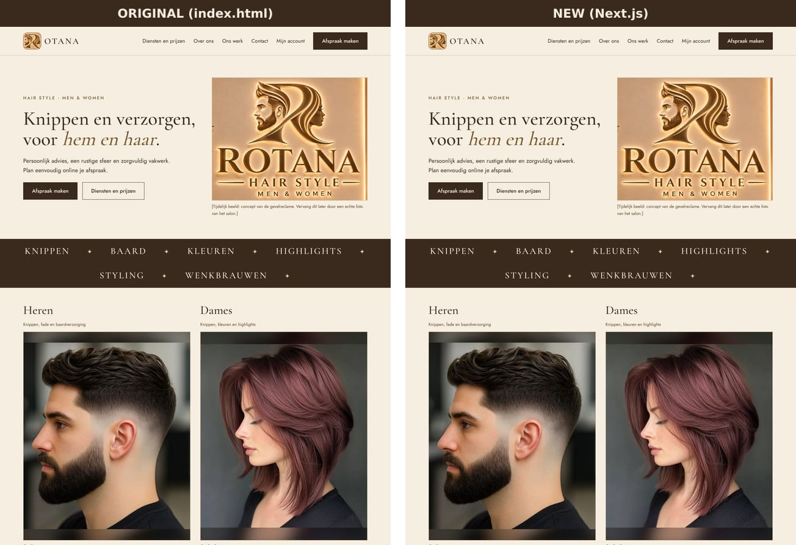
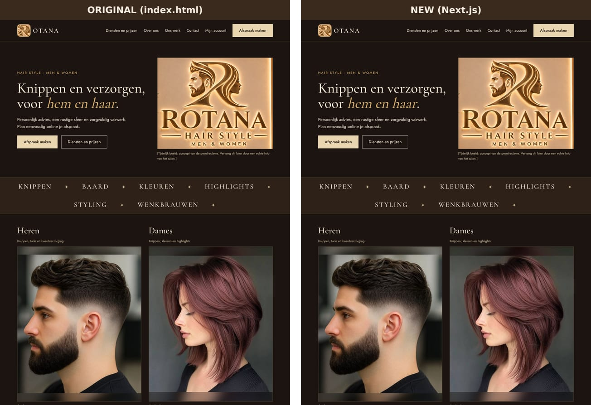
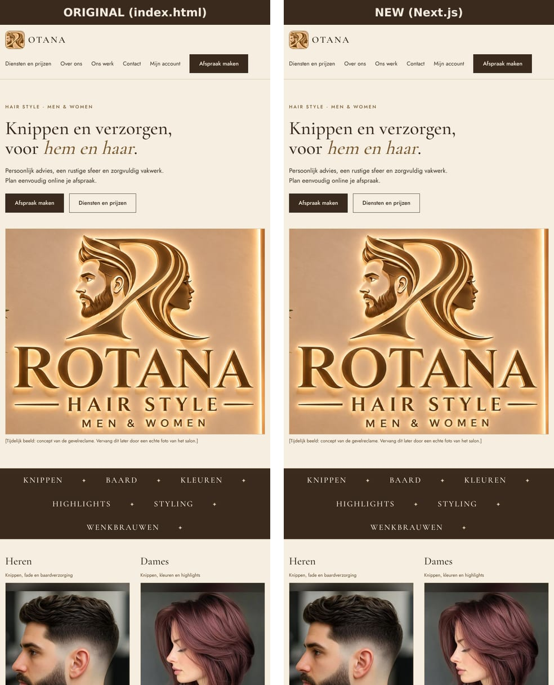
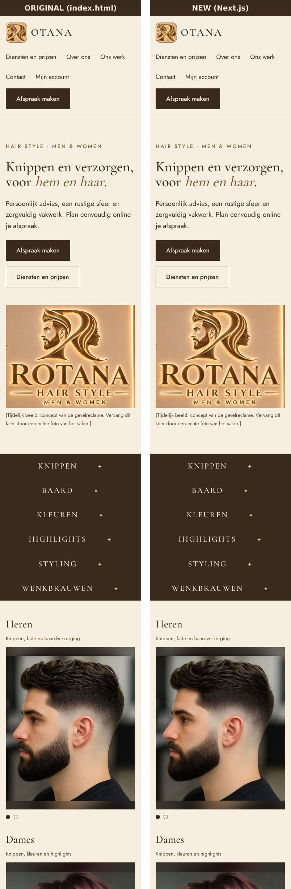
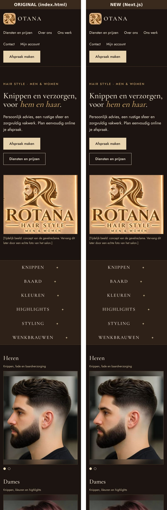
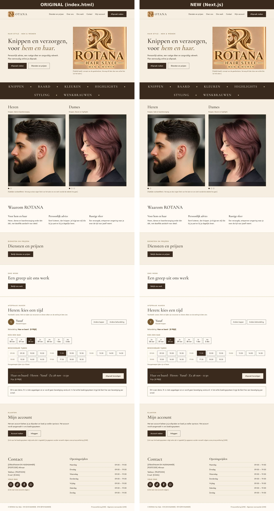
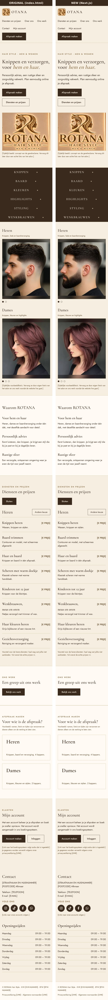
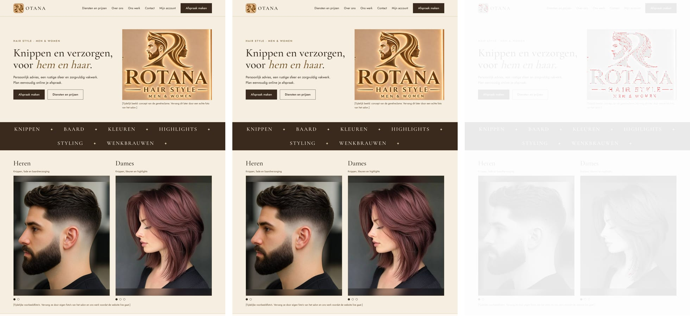

# التقرير النهائي للمرحلة 1: نقل تصميم موقع ROTANA إلى Next.js

**المستودع:** `v476b4n57h-tech/rotana`
**فرع العمل:** `claude/intelligent-fermat-o1jgwp`
**آخر commit:** `5651159` (قبل إضافة هذا التقرير)
**التاريخ:** 25 نوفمبر 2026

> **الجواب المختصر: نعم، المرحلة 1 مكتملة.** كل الاختبارات ناجحة على GitHub، والتصميم مطابق للأصل، و`main` لم يُلمس. التفاصيل الكاملة لكل ملف وكل خطوة في الملحق: [`ROTANA-PHASE-1-DETAILS.md`](ROTANA-PHASE-1-DETAILS.md).

---

## الفهرس

- [قاموس مصطلحات مبسط](#قاموس-مصطلحات-مبسط)
- [1. هل حُلّت مشكلة اختبارات المقارنة البصرية؟](#1-هل-حلت-مشكلة-اختبارات-المقارنة-البصرية)
- [2. هل كل اختبارات GitHub Actions ناجحة؟](#2-هل-كل-اختبارات-github-actions-ناجحة)
- [3. هل حُفظ التصميم والألوان والصور والخطوط؟](#3-هل-حفظ-التصميم-والألوان-والصور-والخطوط)
- [4. هل اختُبر الموقع على الكمبيوتر والجوال والوضع الليلي؟](#4-هل-اختبر-الموقع-على-الكمبيوتر-والجوال-والوضع-الليلي)
- [5. هل رُفعت كل التعديلات إلى الفرع المخصص؟](#5-هل-رفعت-كل-التعديلات-إلى-الفرع-المخصص)
- [6. هل بقي main دون تعديل؟](#6-هل-بقي-main-دون-تعديل)
- [7. هل توجد مشاكل أو مخاطر متبقية؟](#7-هل-توجد-مشاكل-أو-مخاطر-متبقية)
- [8. كيف تشغّل الموقع وتعاينه بنفسك؟](#8-كيف-تشغل-الموقع-وتعاينه-بنفسك)
- [صور المقارنة: الأصل والجديد](#صور-المقارنة-الأصل-والجديد)

---

## قاموس مصطلحات مبسط

| المصطلح                                              | معناه ببساطة                                                                                                           |
| ---------------------------------------------------- | ---------------------------------------------------------------------------------------------------------------------- |
| **Visual Regression Test** (اختبار المقارنة البصرية) | برنامج يصوّر الموقع ويقارن الصورة بصورة "مرجعية"، ليكتشف أي تغيّر في الشكل ولو كان صغيراً. عندنا، المرجع هو الموقع الأصلي |
| **Pixel** (بكسل)                                     | أصغر نقطة ملوّنة على الشاشة. شاشة الكمبيوتر الكاملة لموقعنا فيها أكثر من 5 ملايين بكسل                                  |
| **GitHub Actions / CI**                              | "روبوت" على GitHub يشغّل كل الاختبارات تلقائياً عند كل رفع للكود، ويضع علامة ✅ أو ❌                                    |
| **Commit**                                           | "نقطة حفظ" للكود مع وصف لما تغيّر، يمكن الرجوع إليها دائماً                                                              |
| **Branch** (فرع)                                     | نسخة موازية من المشروع نعمل عليها دون التأثير على الأصل                                                                |
| **main**                                             | الفرع الرئيسي، وفيه نسختك الأصلية                                                                                      |
| **Tag** (علامة)                                      | اسم ثابت لنقطة حفظ معينة. علامتنا `v0-static-demo` تشير إلى الموقع الأصلي                                              |
| **Next.js**                                          | أداة لبناء مواقع حديثة وسريعة، ويُبنى بها موقع ROTANA الجديد                                                            |
| **Component** (مكوّن)                                 | قطعة مستقلة من الموقع، مثل قطعة ليغو: الرأس، أو المعرض، أو الحجز                                                       |
| **Build** (بناء)                                     | تحويل الكود إلى نسخة نهائية جاهزة للنشر                                                                                |
| **AVIF / WebP**                                      | صيغ صور حديثة أخف بكثير من JPEG بنفس الجودة                                                                            |
| **Font** (خط)                                        | ملف يحدد شكل الحروف. خطوطنا: Cormorant Garamond للعناوين، و Jost للنصوص                                                |
| **Emulation** (محاكاة)                               | جعل متصفح الكمبيوتر يتصرف كجوال أو جهاز لوحي: نفس حجم الشاشة واللمس                                                    |
| **Node.js / npm**                                    | Node.js يشغّل أدوات الموقع على جهازك، و npm يثبّت المكتبات التي يحتاجها المشروع                                          |
| **localhost**                                        | عنوان يعني "جهازي أنا". الموقع يعمل على جهازك فقط ولا يراه أحد غيرك                                                    |

---

## 1. هل حُلّت مشكلة اختبارات المقارنة البصرية؟

**نعم، حُلّت نهائياً.** الاختبارات البصرية الـ 16 ناجحة على جهاز العمل وعلى GitHub.

### ماذا كانت المشكلة؟

على جهاز العمل كان الاختلاف بين الأصل والجديد أقل من 0.1%. لكن على GitHub ظهر اختلاف بين **1% و2.5%**، ففشل الاختبار. والغريب أن **طول الصفحة كان متطابقاً**، أي أن كل عنصر في مكانه الصحيح.

### كيف اكتشفنا السبب الحقيقي؟

لم أكن أستطيع تنزيل صور GitHub (خادمها محجوب من بيئة العمل)، فأضفت إلى الاختبار **"تقريراً تشخيصياً"** يطبع معلومتين:

1. **أي خطوط حمّلها كل موقع؟** النتيجة: نفس الخطوط ونفس الأوزان في الموقعين.
2. **أين تقع النقاط المختلفة؟** النتيجة: **فقط في مناطق النصوص**، لا في الصور ولا الألوان ولا التخطيط.

إذن: نفس الخط، ونفس المتصفح، والحروف مرسومة بشكل مختلف قليلاً. فقارنت **ملفات الخطوط نفسها**:

|                                  | حجم ملف خط Cormorant |
| -------------------------------- | -------------------- |
| ما يقدّمه Google الآن             | 37,640 بايت          |
| النسخة المحفوظة في الموقع الجديد | 37,776 بايت          |

### السبب الحقيقي

**Google يحدّث ملفات خطوطه من وقت لآخر، وقد يقدّم ملفات مختلفة قليلاً حسب الجهاز.** الموقع الأصلي يطلب الخط من Google عند كل زيارة، فيأخذ أحدث نسخة. الموقع الجديد يحتفظ بنسخة ثابتة حُفظت وقت البناء. على أجهزة GitHub، اختلفت النسختان قليلاً، فاختلف رسم الحروف بشكل لا تلاحظه العين لكن الاختبار يلتقطه.

> **ماذا يعني هذا لك؟** هذا ليس خطأ في الموقع الجديد. بل الموقع الجديد **أكثر ثباتاً**: شكل خطه لا يتغير فجأة عندما يحدّث Google ملفاته، أما الأصل فقد يتغير وحده.

### كيف أصلحناه؟

في الاختبار فقط، يُعطى الموقع الأصلي **نفس ملفات الخطوط** التي يستخدمها الموقع الجديد. هكذا يقيس الاختبار **عملنا نحن** (التصميم والتخطيط والألوان)، لا تحديثات Google. وهناك اختبار منفصل يتأكد أن عائلات الخطوط وأوزانها هي نفسها في الموقعين.

**النتيجة:** نفس الأرقام على جهاز العمل وعلى GitHub، والاختبار لم يعد يعتمد على الإنترنت.

### مشاكل أخرى في نفس الاختبارات حُلّت قبل ذلك

| المشكلة                       | السبب                                                 | الحل                                     |
| ----------------------------- | ----------------------------------------------------- | ---------------------------------------- |
| الصفحة الجديدة أطول بـ 1 بكسل | تصغير صورة اللافتة غيّر نسبة أبعادها بفرق 0.26 بكسل    | تثبيت الأبعاد الأصلية للصورة (960×760)   |
| الاختبار علق ولم ينتهِ         | كان ينتظر صوراً داخل لوحة مغلقة لا يحمّلها المتصفح أصلاً | الانتظار للصور الظاهرة فقط               |
| نافذة الصور اختلفت بنسبة 80%  | التصوير حدث أثناء "التمرير الناعم" للصفحة             | انتظار توقف التمرير تماماً                |
| أيقونات الأصل لم تظهر         | موقع الأيقونات محجوب في بيئة العمل                    | نسخة محلية من نفس الأيقونات للاختبار فقط |

---

## 2. هل كل اختبارات GitHub Actions ناجحة؟

**نعم.** آخر تشغيلين ناجحان بالكامل، بما فيهما آخر commit (`5651159`):
[رابط آخر تشغيل على GitHub](https://github.com/v476b4n57h-tech/rotana/actions/runs/45706049554)

### سجل كل التشغيلات (بكل صراحة)

| #   | الـ commit      | النتيجة | السبب                                                                        |
| --- | --------------- | ------- | ---------------------------------------------------------------------------- |
| 1   | المرحلة 0       | ✅      | -                                                                            |
| 2   | نقل التصميم     | ❌      | ملف تعريفات الصور غير موجود على GitHub                                       |
| 3   | إصلاح التعريفات | ❌      | اختلاف ملفات خطوط Google (القسم 1)                                           |
| 4   | إضافة التشخيص   | ❌      | مقصود: لجمع المعلومات عن السبب                                               |
| 5   | إصلاح الخطوط    | ❌      | خطئي: اسم دالة يبدأ بـ `use` اعترضت عليه أداة الفحص، ورفعته دون الفحص الكامل |
| 6   | تصحيح الاسم     | ✅      | -                                                                            |
| 7   | إضافة التقرير   | ✅      | -                                                                            |

**الدرس الذي طبقته:** منذ التشغيل 6، أشغّل **الفحص الكامل من الصفر** على جهاز العمل قبل كل رفع.

### ماذا يفحص GitHub في كل مرة؟ (13 خطوة، كلها ✅)

| الخطوة             | ماذا تفعل                                               |
| ------------------ | ------------------------------------------------------- |
| تثبيت المكتبات     | `npm ci`                                                |
| جودة الكود         | ESLint: يكتشف الأخطاء الشائعة                           |
| الأنواع            | TypeScript: يتأكد أن البيانات من النوع الصحيح           |
| التنسيق            | Prettier: الكود مكتوب بشكل موحّد                         |
| الاختبارات السريعة | **22** اختباراً: التصميم، والمحتوى، والمال، وحماية الأصل |
| بناء الموقع        | يتأكد أن الموقع يُبنى دون أخطاء                          |
| اختبارات السلوك    | **54** اختباراً: 52 نجحت و2 متخطاة عمداً، على 3 أجهزة     |
| المقارنة البصرية   | **16** مقارنة مع الأصل                                  |
| حفظ صور المقارنة   | تُحفظ على GitHub 14 يوماً لمن يريد رؤيتها                 |

**عن الاختبارين المتخطيين:** رابط "Ons werk" في القائمة يُختبر على الكمبيوتر واللوحي فقط، لأنه نفس الرابط على الجوال.

---

## 3. هل حُفظ التصميم والألوان والصور والخطوط؟

**نعم.**

| العنصر                            | كيف حُفظ                                                                                   | كيف تأكدنا                                                        |
| --------------------------------- | ----------------------------------------------------------------------------------------- | ----------------------------------------------------------------- |
| **الألوان** (19 لوناً، فاتح وليلي) | منسوخة حرفاً بحرف من الأصل                                                                 | اختبار يتأكد من وجود كل لون بنفس القيمة                           |
| **التصميم** (كل قواعد CSS)        | منسوخ حرفياً إلى `globals.css` و `site.css`                                                | اختبار يتأكد من وجود **كل سطر** من تصميم الأصل (أكثر من 150 سطراً) |
| **الخطوط**                        | نفس العائلتين ونفس الأوزان: Cormorant Garamond (500، 600) و Jost (400، 500)               | اختبار للعائلات والأوزان، واختبار في المتصفح أنها محمّلة           |
| **الصور** (22 صورة)               | مستخرجة من الأصل كما هي، وتُعرض بصيغ أخف                                                   | اختبار يتأكد أن كل صورة بوصفها الأصلي                             |
| **النصوص والمحتوى**               | كلمة بكلمة، بما فيها `[€ PRIJS]` و `[TELEFOON]`                                           | اختبار يقارن كل خدمة وكل وصف بالأصل                               |
| **الحركات**                       | الشريط المتحرك، والكلمة المتبدلة، والسلايدر، والظهور التدريجي، ولمعان الشعار، وطفو الصورة | اختبارات سلوك تتأكد من عمل كل حركة                                |

### نتيجة المقارنة البصرية

| الشاشة           | الوضع | الطول (أصلي / جديد) | نسبة الاختلاف        |
| ---------------- | ----- | ------------------- | -------------------- |
| كمبيوتر          | فاتح  | 4227 / 4227         | 0.058%               |
| كمبيوتر          | ليلي  | 4227 / 4227         | 0.058%               |
| لوحي             | فاتح  | 4798 / 4798         | 0.080%               |
| لوحي             | ليلي  | 4798 / 4798         | 0.080%               |
| جوال             | فاتح  | 6272 / 6272         | 0.071%               |
| جوال             | ليلي  | 6272 / 6272         | 0.072%               |
| 10 حالات تفاعلية | فاتح  | متطابق              | من 0.000% إلى 0.085% |

> **كيف تقرأ هذه الأرقام؟** 0.058% تعني حوالي 6 بكسلات من كل 10,000، وكلها **داخل الصور**، لأنها أصبحت بصيغة أخف. طول الصفحة متطابق، أي أن كل عنصر في مكانه بالضبط. العين لا ترى أي فرق.

**الاختلاف الوحيد المقصود:** الصور أخف. مثلاً صورة اللافتة نزلت من **179 KB إلى 18 KB** بنفس الشكل.

---

## 4. هل اختُبر الموقع على الكمبيوتر والجوال والوضع الليلي؟

**نعم.**

| الجهاز           | المقاس                            | ما اختُبر                                                      |
| ---------------- | --------------------------------- | ------------------------------------------------------------- |
| **كمبيوتر**      | 1280 × 800                        | السلوك (18 اختباراً) + المقارنة البصرية (فاتح وليلي + 5 حالات) |
| **جهاز لوحي**    | 820 × 1180 (محاكاة Galaxy Tab S4) | السلوك (18 اختباراً) + المقارنة البصرية (فاتح وليلي)           |
| **جوال**         | 390 × 844 (محاكاة Pixel 7)        | السلوك (18 اختباراً) + المقارنة البصرية (فاتح وليلي + 5 حالات) |
| **الوضع الليلي** | كل المقاسات                       | مقارنة بصرية + اختبار لون الخلفية الليلي الأصلي               |

### ماذا تفحص اختبارات السلوك على كل جهاز؟

- الأقسام العشرة بنفس ترتيب الأصل، ولا يوجد تمرير أفقي خارج الشاشة.
- **لوحة الخدمات:** فتح، و8 خدمات رجالية، و6 نسائية، ورجوع، وإغلاق.
- **المعرض:** 10 صور، والفلترة، ونافذة العرض، والأسهم، وزر Esc.
- **الحجز التجريبي كاملاً:** من اختيار القسم حتى رسالة التأكيد.
- **الحركات:** تعمل، وتتوقف عند تفعيل "تقليل الحركة" في الجهاز.
- **بدون JavaScript:** كل المحتوى يبقى ظاهراً.
- **سلامة المتصفح:** لا توجد أي أخطاء في المتصفح أثناء أي اختبار.

**تنبيه صريح:** الاختبارات تمت بمتصفح Chrome فقط، مع **محاكاة** الجوال واللوحي، لا على أجهزة حقيقية. التفاصيل في القسم 7.

---

## 5. هل رُفعت كل التعديلات إلى الفرع المخصص؟

**نعم.**

| الفحص                             | النتيجة                                       |
| --------------------------------- | --------------------------------------------- |
| الفرع على GitHub = النسخة المحلية | ✅ كلاهما عند `5651159` قبل هذا التقرير       |
| ملفات غير محفوظة أو غير مرفوعة    | ✅ لا يوجد                                    |
| هذا التقرير وصور المقارنة         | ✅ مرفوعة في commit منفصل، ومذكورة في القسم 2 |

**الـ commits في المرحلة 1:**

| Commit    | الوصف                              |
| --------- | ---------------------------------- |
| `59678c5` | نقل التصميم كاملاً إلى Next.js      |
| `ffa1fca` | إصلاح فحص الأنواع على GitHub       |
| `20344f6` | تقرير تشخيصي للمقارنة البصرية      |
| `3907551` | المقارنة البصرية بنفس ملفات الخطوط |
| `90ce048` | تصحيح اسم دالة في الاختبارات       |
| `5651159` | التقرير الأول ولقطات الشاشة        |
| (التالي)  | هذا التقرير النهائي وصور المقارنة  |

---

## 6. هل بقي main دون تعديل؟

**نعم، لم يُلمس إطلاقاً.**

| الفحص                     | النتيجة                                                                    |
| ------------------------- | -------------------------------------------------------------------------- |
| `main` على GitHub         | ✅ ما زال عند `7292fb5`، أي النسخة الأصلية                                 |
| العلامة `v0-static-demo`  | ✅ تشير إلى `7292fb5`                                                      |
| الملف الأصلي `index.html` | ✅ بصمته مطابقة للأصل (`6e1cdd03…`)، واختبار آلي يتحقق من ذلك عند كل تشغيل |
| دمج أو Pull Request       | ✅ لم يُنشأ أي دمج ولا طلب دمج                                              |
| خدمات مدفوعة              | ✅ لم يُفعَّل أو يُشترَ أي شيء                                                  |

---

## 7. هل توجد مشاكل أو مخاطر متبقية؟

لا توجد مشاكل تمنع الانتقال للمرحلة 2. لكن هذه نقاط يجب أن تعرفها، مرتبة حسب الأهمية:

| #   | النقطة                                                                                                | الخطورة    | ماذا نفعل؟                                                                                                                                                 |
| --- | ----------------------------------------------------------------------------------------------------- | ---------- | ---------------------------------------------------------------------------------------------------------------------------------------------------------- |
| 1   | **الاختبارات بمتصفح Chrome فقط وبالمحاكاة.** لم يُختبر Safari (آيفون) ولا Firefox، ولا أجهزة حقيقية    | متوسطة     | التصميم منسوخ حرفياً من الأصل، فسيتصرف مثل الأصل على Safari. **أقترح** إضافة Safari و Firefox لفحص GitHub (مجاناً)، ومعاينة الموقع على جوالك عبر رابط Vercel |
| 2   | **الموقع ما زال تجريبياً:** الحجز وهمي، والأسعار والهاتف والعنوان فارغة، وأسماء الحلاقين وهمية         | متوقعة     | هذا مقصود في المرحلة 1. البيانات الحقيقية تأتي في المراحل 2 إلى 5. **لا يُنشر الموقع للعامة قبل ذلك**                                                       |
| 3   | **عيب في التصميم الأصلي:** عنوان "JOUW AFSPRAAK" في ملخص الحجز يكاد لا يُقرأ (نص داكن على خلفية داكنة) | منخفضة     | تركته التزاماً بطلبك. التصحيح سطر واحد، **وينتظر موافقتك**                                                                                                  |
| 4   | **خاصية تجريبية في Next.js** (`inlineCss`): تدمج التصميم في الصفحة لتسريع أول ظهور على الجوال         | منخفضة     | مختبرة وتعمل. إن ظهرت مشكلة تُطفأ بسطر واحد                                                                                                                 |
| 5   | **حدود الخطة المجانية في Vercel لتحويل الصور** إلى صيغ حديثة                                          | منخفضة     | لا يؤثر الآن. نراجعها عند النشر الفعلي                                                                                                                     |
| 6   | **تحذير على GitHub:** بعض أدوات GitHub Actions المستخدمة قديمة (Node.js 20)                           | منخفضة جداً | مجرد تحذير، والفحص يعمل. نحدّثها لاحقاً بتعديل صغير                                                                                                          |
| 7   | **صور التقارير محفوظة في المستودع** (حوالي 4 MB)                                                      | منخفضة جداً | مقبول. يمكن نقلها لاحقاً إن أردت مستودعاً أخف                                                                                                                |

---

## 8. كيف تشغّل الموقع وتعاينه بنفسك؟

### الطريقة 1: تصفّح الملفات على GitHub (الأسهل، بدون تثبيت أي شيء)

1. افتح: https://github.com/v476b4n57h-tech/rotana
2. من زر الفروع (مكتوب عليه `main`) اختر **`claude/intelligent-fermat-o1jgwp`**.
3. افتح المجلد `docs/reports/phase-1/` لترى هذا التقرير مع الصور مباشرة.
4. **لرؤية صور المقارنة التي صنعها GitHub:** افتح تبويب **Actions**، ثم آخر تشغيل، ثم في الأسفل نزّل **visual-comparison**.

> هذه الطريقة تعرض الملفات والصور، لكنها لا تشغّل الموقع.

### الطريقة 2: تشغيل الموقع على جهازك (حوالي 10 دقائق في المرة الأولى)

**ما تحتاجه مرة واحدة:**

- **Node.js** الإصدار 22 أو أحدث من https://nodejs.org (اختر نسخة LTS).
- **Git** من https://git-scm.com.

**الخطوات:** افتح الطرفية (Terminal في ماك، أو PowerShell في ويندوز) واكتب الأوامر التالية، واحداً تلو الآخر.

1. نزّل المشروع من GitHub إلى جهازك:

```bash
git clone https://github.com/v476b4n57h-tech/rotana.git
```

2. ادخل إلى مجلد المشروع:

```bash
cd rotana
```

3. انتقل إلى فرع العمل الذي فيه الموقع الجديد:

```bash
git checkout claude/intelligent-fermat-o1jgwp
```

4. ثبّت المكتبات التي يحتاجها المشروع (مرة واحدة، تستغرق دقيقة أو اثنتين):

```bash
npm install
```

5. شغّل الموقع:

```bash
npm run dev
```

6. افتح المتصفح على العنوان: **http://localhost:3000**

**لإيقاف الموقع:** اضغط `Ctrl + C` في الطرفية.

**لرؤية الموقع الأصلي للمقارنة:** افتح الملف `index.html` من مجلد المشروع بالنقر المزدوج عليه.

**نصائح للمعاينة:**

- **الوضع الليلي:** فعّل الوضع الداكن في نظام جهازك، فيتبعه الموقع تلقائياً.
- **شكل الجوال على الكمبيوتر:** في Chrome اضغط `F12`، ثم أيقونة الجوال في الأعلى.
- **رؤيته على جوالك الحقيقي:** الطريقة 3 هي الأسهل.

**تشغيل كل الاختبارات بنفسك (اختياري):**

ثبّت متصفح الاختبارات (مرة واحدة):

```bash
npx playwright install chromium
```

ثم شغّل الفحص الكامل (حوالي دقيقتين):

```bash
npm run check
```

### الطريقة 3: رابط معاينة على Vercel (لرؤيته على جوالك)

Vercel ينشئ رابطاً حقيقياً للموقع على الإنترنت يمكنك فتحه من أي جهاز. **لم أفعّله، لأنه يتطلب موافقتك وحسابك.**

1. أنشئ حساباً **مجانياً** على https://vercel.com بالتسجيل عبر GitHub.
2. اختر **Add New → Project**، ثم مستودع `rotana`.
3. Vercel يتعرف على Next.js تلقائياً. اضغط **Deploy**.
4. كل فرع يحصل على **رابط معاينة** خاص به، و`main` لا يتأثر.

> **ملاحظة:** الخطة المجانية مسموحة للمعاينة الشخصية. النشر التجاري للعامة يتطلب لاحقاً الخطة المدفوعة، وهذا قرارك عند الإطلاق.

---

## صور المقارنة: الأصل والجديد

في كل صورة: **اليسار هو الأصل** (`index.html`)، و**اليمين هو الجديد** (Next.js).

### الكمبيوتر: الوضع الفاتح



### الكمبيوتر: الوضع الليلي



### الجهاز اللوحي: الوضع الفاتح



### الجوال: الوضع الفاتح والليلي

| فاتح                                               | ليلي                                              |
| -------------------------------------------------- | ------------------------------------------------- |
|  |  |

### حالات تفاعلية: الحجز حتى التأكيد (كمبيوتر)



### حالات تفاعلية: الخدمات (جوال)



### خريطة الاختلافات

من اليسار: الأصل، ثم الجديد، ثم **خريطة الاختلاف**. النقاط الحمراء هي البكسلات المختلفة، وتظهر فقط داخل صورة اللافتة بسبب ضغطها بصيغة أخف:



---

## الخطوة التالية

**المرحلة 2: قاعدة البيانات** (الصالونات والفروع والخدمات والحلاقين والحجوزات والنظام المالي، مع الأمان ومنع تعارض الحجوزات).

**قرارات تنتظرك:**

1. الموافقة على بدء المرحلة 2.
2. تصحيح عنوان "JOUW AFSPRAAK" (نعم / لا).
3. إضافة Safari و Firefox إلى فحص GitHub (نعم / لا).
4. إنشاء حساب Supabase مجاني (منطقة Frankfurt) قبل المرحلة 2، وإنشاء حساب Vercel إن أردت رابط معاينة.

**لن أبدأ المرحلة 2، ولن أدمج أي فرع، ولن أفعّل أي خدمة قبل موافقتك.**
